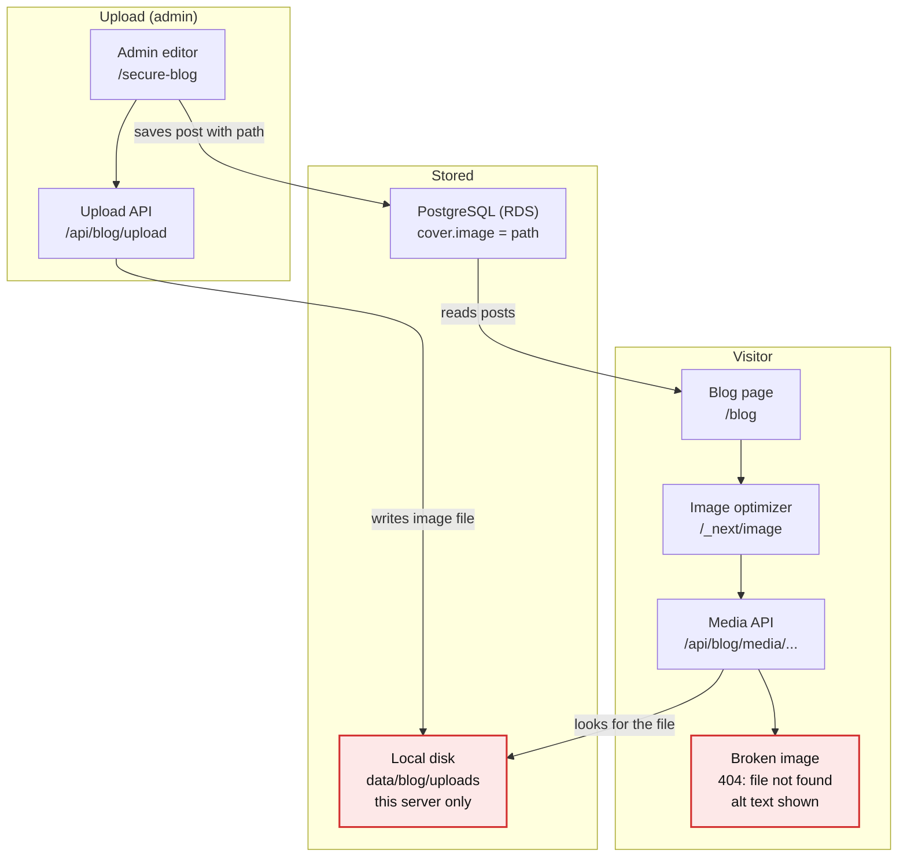
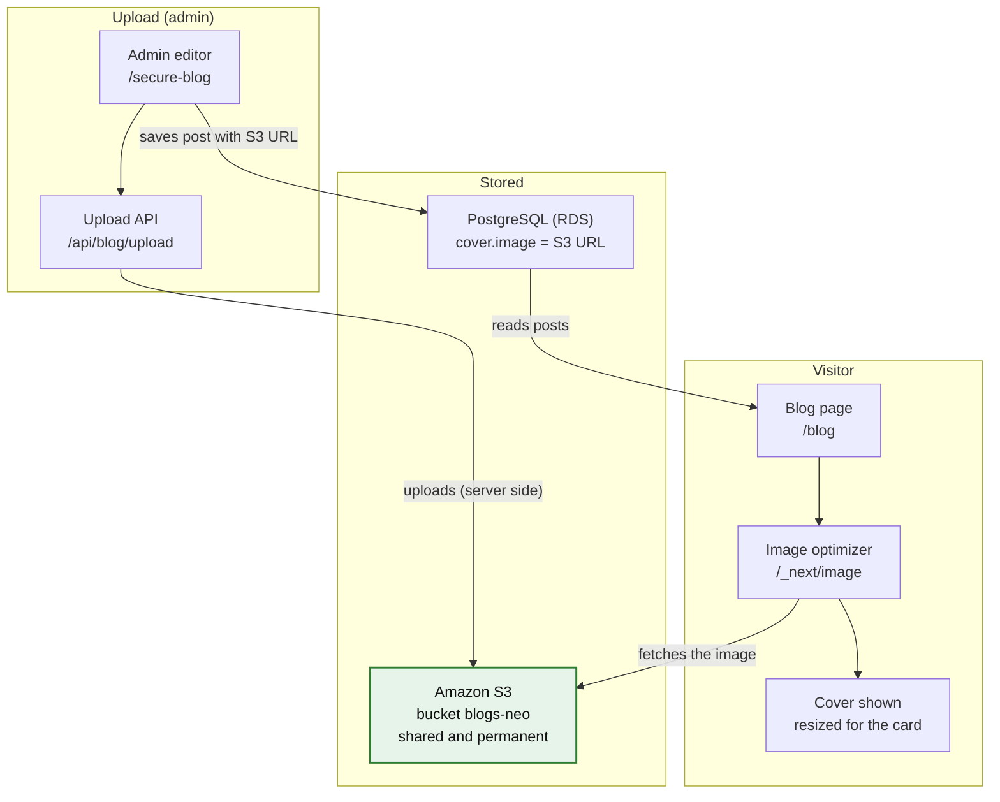

# Blog Cover Images: Issue and S3 Fix

_As of 26 Oct 2026_

## Summary

Uploaded cover images do not show on the blog page because the image file lives on one server's local disk, while only its path is saved in PostgreSQL. Any server that does not have that file, including every AWS Amplify server, returns 404 for it, and the card shows the alt text instead of the picture.

The fix is to upload each image to Amazon S3 and save the full S3 URL in the database. Every server and every deploy then loads the same file from one place.

- **Root cause:** images are stored in `data/blog/uploads` on disk, not in shared storage.
- **Made worse by:** prefixing the image path with `http://localhost:3000`, which Next.js 16 refuses to load.
- **Fix:** S3 upload in `/api/blog/upload`, S3 URL saved in `cover.image`, S3 host allowed in `next.config.js`.

**Do first:** the real RDS password is on GitHub in commit `762999b` (`.env.example`). Rotate it before anything else; see [Amplify and security](#amplify-and-security).

## Current setup

Today an upload writes the image to the disk of whichever server received it, and the post in PostgreSQL stores only the path `/api/blog/media/<name>`. The page can show the image only while that same disk still has the file.



On your machine the file was gone, and on Amplify it never lasts, so the media API returns 404 and the card shows the alt text.

## The issue

Both uploaded covers return 404 because their files are no longer on disk, while the database still points to them. Checked against the running dev server on 26 Oct 2026:

| Check | Result |
| --- | --- |
| `GET /api/blog/media/mvow6bgw-3259c61855e3.png` | 404 Not found |
| `data/blog/uploads` folder | Empty |
| Upload times (encoded in the file names) | 12:14 and 12:15 IST |
| Folder last changed | 12:24 IST: files removed after upload, or uploaded on another machine |

Affected posts: **Why DIY RAG Pipelines Fail in Production** (`mvow6bgw-3259c61855e3.png`) and **Observability for Agentic Systems: What We Actually Measure** (`mvow6zot-099b49eb0465.jpg`).

### Why it also fails in production

AWS Amplify's server runtime has no shared, permanent disk. Files written at runtime are not kept across deploys and are not shared between server instances. The code already warns about this in `lib/blog/store.ts`: uploads need a writable filesystem. So an upload only ever works on the machine that received it.

### Why the localhost prefix made it worse

The uncommitted change in `components/BlogCover.tsx` builds the image URL as `${NEXT_PUBLIC_SITE_URL}${cover.image}`, so the image source becomes `http://localhost:3000/api/blog/media/...`. Tested with a valid image file in place:

| `src` passed to `<Image>` | Result through `/_next/image` |
| --- | --- |
| `/api/blog/media/x.png` (original code) | 200, image served |
| `http://localhost:3000/api/blog/media/x.png` (new code) | 400 `"url" parameter is not allowed` |

- Next.js 16 stops the image optimizer from fetching hosts that resolve to private addresses such as `127.0.0.1` (`images.dangerouslyAllowLocalIP` is `false` by default).
- `NEXT_PUBLIC_SITE_URL` is fixed at build time, and `remotePatterns` only allows `localhost:3000`, so the live domain would never match.
- External `https://` covers would become `http://localhost:3000https://...`.

This change should be reverted. The S3 fix does not need it.

## The fix with S3

The server uploads each image to S3, and the post saves the image's full public URL. Any server, on any deploy, then loads the same file.



The editor and validation stay as they are. Only the upload API, the image settings and the cover component change.

### Design decisions

- **Upload on the server, not from the browser.** The browser sends the file to `/api/blog/upload`, which uploads it to S3. The keys never leave the server, and the existing admin check, 5 MB limit and file-type check still apply. Browser-direct uploads would need presigned URLs, bucket CORS and a second copy of those checks.
- **Full URL in the database.** `cover.image` holds `https://blogs-neo.s3.ap-south-1.amazonaws.com/blog/covers/<name>`. Pages use it as-is, so no `NEXT_PUBLIC_SITE_URL` prefix is needed.
- **Public read on `blog/` only.** A bucket policy makes that folder readable and keeps the rest of the bucket private. File names end in 12 random hex characters, so they cannot be guessed.
- **Unique names, long cache.** Each name is a timestamp plus random hex, as today, so a file never changes and browsers can cache it for a year.
- **Resized by Next.js.** S3 images go through the image optimizer, so cards load a resized copy instead of an original of up to 5 MB.

## AWS setup

Use the existing bucket `blogs-neo` in `ap-south-1` (the `BUCKET_NAME` and `REGION` already in `.env.local`). Make only the `blog/` folder publicly readable, and let the access key upload into that folder and nothing else.

1. **Object ownership:** keep the default, _ACLs disabled_. Public access comes from the bucket policy, not from per-file ACLs.
2. **Block Public Access:** in the bucket's _Permissions_ tab, turn off the two settings about _bucket policies_. Leave the two _ACL_ settings on.
3. **Bucket policy** (public read for blog images only):

    ```json
    {
      "Version": "2012-10-17",
      "Statement": [{
        "Sid": "PublicReadBlogImages",
        "Effect": "Allow",
        "Principal": "*",
        "Action": "s3:GetObject",
        "Resource": "arn:aws:s3:::blogs-neo/blog/*"
      }]
    }
    ```

4. **IAM user policy** for the user that owns `ACCESS_KEY_ID` (upload only, into `blog/`):

    ```json
    {
      "Version": "2012-10-17",
      "Statement": [{
        "Effect": "Allow",
        "Action": "s3:PutObject",
        "Resource": "arn:aws:s3:::blogs-neo/blog/*"
      }]
    }
    ```

    Add `s3:DeleteObject` later only if the editor gets a delete-image button.

5. **CORS:** not needed. The browser sends the file to our own `/api/blog/upload`, and the server uploads it to S3.

Each uploaded image gets a URL like `https://blogs-neo.s3.ap-south-1.amazonaws.com/blog/covers/mvow6bgw-3259c61855e3.png`. A CloudFront distribution in front of the bucket (caching, custom domain) can be added later without changing the code.

## Code changes

The fix adds one file, `lib/blog/s3.ts`, and makes small edits to the rest. The editor (`PostEditor.tsx`) needs no change: it already saves whatever URL the upload API returns. Validation needs no change either: S3 URLs start with `https://`, which `isValidCoverImage` already accepts.

### 1. Revert the localhost change

```bash
git checkout -- components/BlogCover.tsx next.config.js lib/blog/utils.ts
```

Also remove the debug `console.log` in `app/blog/page.tsx`.

### 2. Add the S3 SDK to package.json

`@aws-sdk/client-s3` is in `node_modules` but not in `package.json` (`npm ls` marks it _extraneous_), so Amplify would not install it.

```bash
npm install @aws-sdk/client-s3
```

### 3. Environment variables (`.env.local`)

The names already exist in `.env.local`. They are server-only: never prefix them with `NEXT_PUBLIC_`, or the secret key ships to every browser.

```bash
ACCESS_KEY_ID=...
SECRET_ACCESS_KEY=...
BUCKET_NAME=blogs-neo
REGION=ap-south-1
```

### 4. New file: `lib/blog/s3.ts`

```ts
import { PutObjectCommand, S3Client } from '@aws-sdk/client-s3'

const REQUIRED_ENV = ['ACCESS_KEY_ID', 'SECRET_ACCESS_KEY', 'BUCKET_NAME', 'REGION'] as const

const CONTENT_TYPES: Record<string, string> = {
  png: 'image/png',
  jpg: 'image/jpeg',
  webp: 'image/webp',
  gif: 'image/gif',
  avif: 'image/avif',
}

let client: S3Client | undefined

function readConfig() {
  const missing = REQUIRED_ENV.filter((key) => !process.env[key])
  if (missing.length) {
    throw new Error(`Image storage is not configured: set ${missing.join(', ')} in .env.local.`)
  }
  return { bucket: process.env.BUCKET_NAME!, region: process.env.REGION! }
}

/** Uploads a cover image to S3 and returns its public URL. */
export async function uploadCoverImage(name: string, bytes: Uint8Array): Promise<string> {
  const { bucket, region } = readConfig()
  client ??= new S3Client({
    region,
    credentials: {
      accessKeyId: process.env.ACCESS_KEY_ID!,
      secretAccessKey: process.env.SECRET_ACCESS_KEY!,
    },
  })

  const key = `blog/covers/${name}`
  await client.send(
    new PutObjectCommand({
      Bucket: bucket,
      Key: key,
      Body: bytes,
      ContentType: CONTENT_TYPES[name.split('.').pop()!],
      // Upload names are unique, so the content never changes.
      CacheControl: 'public, max-age=31536000, immutable',
    })
  )
  return `https://${bucket}.s3.${region}.amazonaws.com/${key}`
}
```

### 5. `app/api/blog/upload/route.ts`

Keep the admin check, size limit and file-type check as they are. Replace only the last two lines (`saveUpload` and the `/api/blog/media/` response):

```ts
import { uploadCoverImage } from '@/lib/blog/s3'

// ...after the name is generated:
try {
  const url = await uploadCoverImage(name, bytes)
  return NextResponse.json({ url })
} catch (error) {
  console.error('S3 upload failed:', error)
  return NextResponse.json({ error: 'Could not save the image. Please try again.' }, { status: 502 })
}
```

The returned URL is what the editor puts in `cover.image`, so the full S3 URL is what gets saved in PostgreSQL.

### 6. `next.config.js`

Allow the bucket host so the Next.js image optimizer can resize S3 images. Uploads can be up to 5 MB, and the cards are about 400 px wide.

```js
/** @type {import('next').NextConfig} */
const nextConfig = {
  images: {
    remotePatterns: [
      // Keep in sync with COVER_IMAGE_HOST in lib/blog/types.ts.
      { protocol: 'https', hostname: 'blogs-neo.s3.ap-south-1.amazonaws.com', pathname: '/blog/**' },
    ],
  },
}

module.exports = nextConfig
```

### 7. `lib/blog/types.ts` and `components/BlogCover.tsx`

Today every `https://` cover skips the optimizer, which would include S3 images. Add the host as a plain constant, not an environment variable, because `BlogCover` also renders in the client component `BlogManager.tsx`:

```ts
// lib/blog/types.ts
export const COVER_IMAGE_HOST = 'blogs-neo.s3.ap-south-1.amazonaws.com'
```

```tsx
// components/BlogCover.tsx (keep src={cover.image}, as in the original)
unoptimized={
  cover.image.startsWith('https://') &&
  !cover.image.startsWith(`https://${COVER_IMAGE_HOST}/`)
}
```

### 8. Clean up later

Once no post points to `/api/blog/media/`, delete `app/api/blog/media/[file]/route.ts`, `saveUpload` and `readUpload` in `lib/blog/store.ts`, `MEDIA_URL_PATTERN` in `lib/blog/validate.ts`, and the `data/blog/uploads` folder.

Bonus: Open Graph images in `app/blog/[slug]/page.tsx` now get an absolute URL, so link previews show the cover too.

## Amplify and security

The S3 keys must reach the Amplify server at runtime and must never reach git or the browser. Separately, the real database password is already on GitHub and needs rotating.

### Environment variables on Amplify

- Add `ACCESS_KEY_ID`, `SECRET_ACCESS_KEY`, `BUCKET_NAME` and `REGION` in the Amplify console under _Environment variables_. Keep these names: Amplify does not allow names that start with `AWS_`, so do not rename them to `AWS_ACCESS_KEY_ID`.
- Amplify does not hand console variables to the Next.js server at runtime by itself. Check how the `DB_*` variables reach the server today and add the S3 ones the same way. If the build spec has no such step, add this line before `npm run build` in the build spec in the Amplify console (this project keeps the build spec there, not in the repo):

    ```bash
    env | grep -E '^(DB_[A-Z_]+|ACCESS_KEY_ID|SECRET_ACCESS_KEY|BUCKET_NAME|REGION)=' >> .env.production
    ```

### Keeping the keys safe

- Keys live only in `.env.local` (already ignored by git through `.env*.local`) and in the Amplify console.
- Never use the `NEXT_PUBLIC_` prefix for keys. Anything with that prefix is bundled into the browser JavaScript.
- The IAM user can only upload into `blogs-neo/blog/*` (see [AWS setup](#aws-setup)), so a leaked key cannot read or delete anything else.

### Credentials already exposed

| Where | What | Pushed to GitHub? | Action |
| --- | --- | --- | --- |
| Commit `762999b`, `.env.example` | Real RDS host, user and password | Yes, on `claude/build-portfolio-website-L2YC4` | Rotate the RDS password now, then update `.env.local` and Amplify |
| Local commits `30317be` and `b875a87`, `.env.example` | S3 access key and secret | No, rebased away before any push | Never push or cherry-pick them; rotate the key too if they may exist on another machine |

Deleting `.env.example` in a later commit does not remove it from git history: anyone who can see the repo can still read commit `762999b`.

## Rollout and testing

Do these in order. Each test step names what you should see before you move on.

- [ ] Rotate the RDS password (exposed in commit `762999b`), then update `.env.local` and the Amplify console.
- [ ] Revert the localhost change and remove the debug `console.log` lines ([Code changes](#code-changes), step 1).
- [ ] Apply the bucket policy and IAM policy ([AWS setup](#aws-setup)).
- [ ] Make code changes 2 to 7.
- [ ] **Local test:** run `npm run dev`, upload a cover in `/secure-blog`, save the post. In the database, `cover.image` should start with `https://blogs-neo.s3.ap-south-1.amazonaws.com/blog/covers/`, and that URL should open in the browser.
- [ ] **Build test:** run `npm run build` then `npm start`, open `/blog`. The cover should load through `/_next/image?url=https%3A%2F%2Fblogs-neo...` with status 200.
- [ ] Upload new covers for the two affected posts: _Why DIY RAG Pipelines Fail in Production_ and _Observability for Agentic Systems: What We Actually Measure_.
- [ ] Add the four S3 variables in the Amplify console and the build spec ([Amplify and security](#amplify-and-security)), then deploy.
- [ ] **Live test:** upload one image on the live site and confirm it shows on `/blog` after a refresh and after the next deploy.
- [ ] When no post uses `/api/blog/media/`, do the clean-up ([Code changes](#code-changes), step 8).
